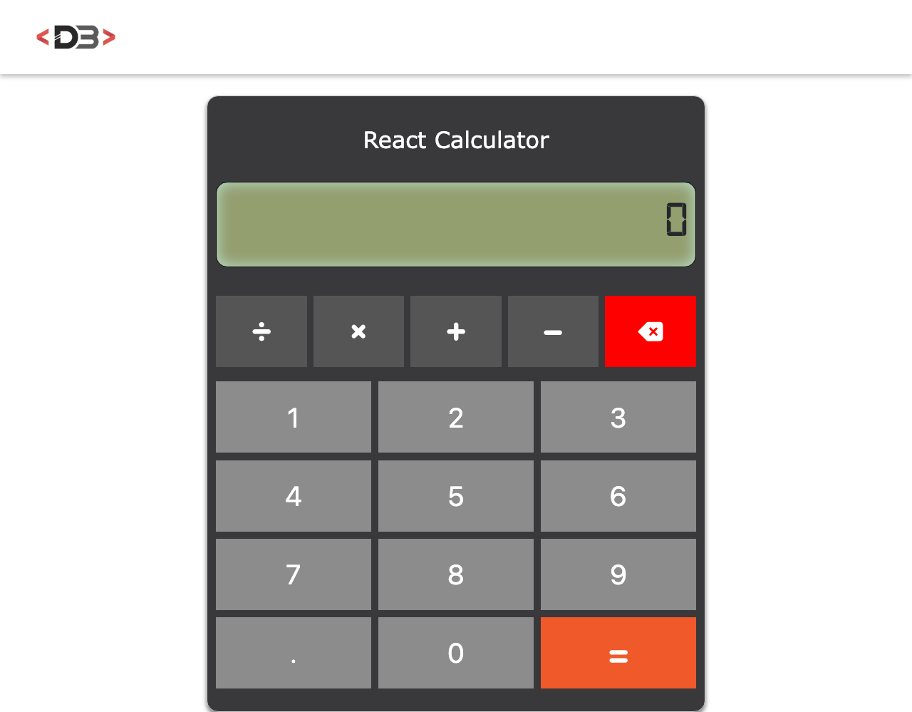

# React Calculator

A simple, responsive calculator built with React.
It shows a live preview of the result while you type and supports the four basic operations with decimal numbers.

**Live demo:** https://davidebalice.github.io/react-calculator/



## Features

- Addition, subtraction, multiplication and division
- Decimal numbers
- Live preview of the result while typing
- Backspace to delete the last character
- Safe expression parser (no `eval`)
- Responsive layout

## Tech stack

- [React 18](https://react.dev/)
- [Vite](https://vite.dev/)
- [Bootstrap 5](https://getbootstrap.com/)
- [React Icons](https://react-icons.github.io/react-icons/)
- CSS Modules

## Getting started

### Requirements

- Node.js 20 or later
- npm

### Installation

```bash
git clone https://github.com/davidebalice/react-calculator.git
cd react-calculator
npm install
```

### Available scripts

| Command           | Description                              |
| ----------------- | ---------------------------------------- |
| `npm run dev`     | Start the development server             |
| `npm run build`   | Create a production build in `dist/`     |
| `npm run preview` | Preview the production build locally     |

## Deployment

The app is deployed automatically to GitHub Pages by a GitHub Actions workflow
(`.github/workflows/deploy.yml`) on every push to `main`.

## Project structure

```
src/
├── common/        # Header component
├── components/    # Calculator component and expression evaluator
├── assets/        # Images
└── main.jsx       # Application entry point
```

## Author

**Davide Balice** – [davidebalice.dev](https://www.davidebalice.dev)
